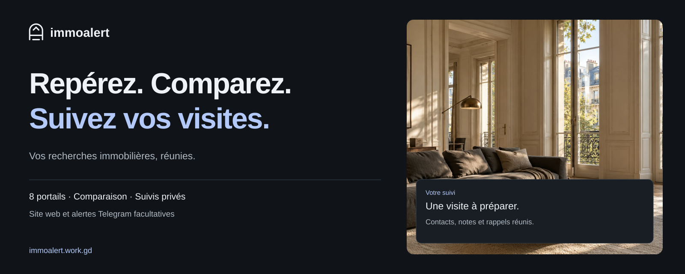
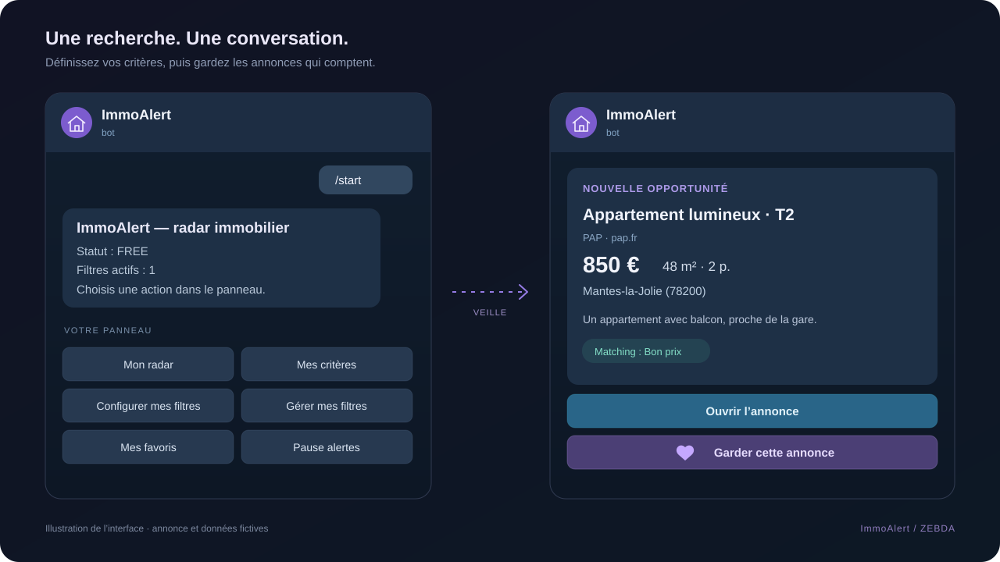
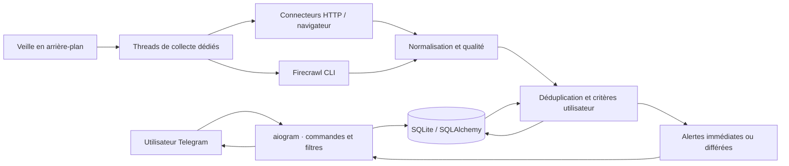

<div align="center">



# ImmoAlert

**Les annonces qui vous intéressent. Directement dans Telegram.**

Surveillez plusieurs portails, définissez vos critères et retrouvez vos favoris dans une seule conversation.

[](https://github.com/ZEBDA1/ImmoAlert/actions/workflows/ci.yml)


[Aperçu](#aperçu) · [Fonctionnalités](#fonctionnalités) · [Démarrage rapide](#démarrage-rapide) · [Architecture](#architecture) · [Documentation](#documentation)

</div>

---

Chercher un logement finit souvent par ressembler à une tournée de sites : les mêmes filtres, les mêmes annonces, plusieurs onglets à rafraîchir. **ImmoAlert rassemble cette veille dans Telegram.** Chaque utilisateur configure sa recherche ; le bot collecte les annonces, vérifie les critères, repère les doublons et prépare les alertes.

Le projet se déploie sur votre serveur avec Docker Compose. Il intègre **8 connecteurs**, des filtres nommés, des favoris, une file d’alertes persistante et des outils de diagnostic accessibles aux administrateurs.

## Aperçu



*Illustration de la conversation et de ses commandes, avec une annonce fictive. Le format des alertes et les libellés des boutons reprennent le code du bot ; ce visuel est une maquette, pas une capture de Telegram. [Provenance des visuels](docs/assets/README.md).*

## Fonctionnalités

| Fonction | Ce que propose ImmoAlert |
| :--- | :--- |
| **🎯 Une recherche à votre mesure** | Ville, code postal, prix minimum et maximum, surface, pièces, type de bien et budget avec charges. Rayon géographique avec le géocodage optionnel. |
| **🛰️ Plusieurs sources** | Connecteurs Leboncoin, SeLoger, PAP, ParuVendu, Entreparticuliers, Logic-Immo, Rentola et OuestFrance-Immo. |
| **🔔 Des alertes lisibles** | Prix, surface, localisation, source, score de correspondance, photo lorsqu’elle est disponible et lien vers l’annonce. |
| **❤️ Des favoris à retrouver** | Enregistrement depuis une alerte, retrait et tri par date, prix ou surface. |
| **👥 Plusieurs utilisateurs** | Filtres propres à chaque compte, mode Free à alertes différées et mode Premium avec plusieurs filtres nommés. |
| **🔁 Une veille qui reprend** | Alertes enregistrées en base, nouvelle tentative après une erreur Telegram temporaire et suivi des annonces déjà envoyées. |
| **⚡ Une conversation réactive** | Collectes exécutées dans des threads dédiés pour préserver les ressources utilisées par Telegram, même lorsqu’un portail répond lentement. |
| **🧠 Une IA facultative** | Création d’un filtre en langage naturel via un endpoint configurable, avec un repli local de parsing. Les alertes utilisent des règles locales pour les signaux d’arnaque. |
| **🛠️ Des diagnostics intégrés** | État des sources, erreurs, délais, volumes collectés, test d’un connecteur et scan complet depuis les commandes admin. |

### Sources et disponibilité

| Connecteurs | Collecte |
| :--- | :--- |
| **Leboncoin · SeLoger** | Firecrawl CLI pour le rendu et l’extraction structurée ; chemins HTTP ou navigateur en repli. |
| **PAP · ParuVendu · Entreparticuliers** | Extraction HTTP et parseurs propres à chaque portail. |
| **Logic-Immo · Rentola · OuestFrance-Immo** | Connecteurs dédiés, intégrés au même cycle de normalisation et de filtrage. |

Les connecteurs sont présents dans le code ; leur disponibilité dépend des sites, des protections anti-bot, du réseau et des quotas Firecrawl. Un connecteur peut renvoyer zéro résultat. `/debug_sources` permet de voir ce qui a réellement été collecté.

## Démarrage rapide

**Prérequis : Git et Docker avec le plugin Compose.** L’image installe Python 3.11, Chromium, Node.js 22 et Firecrawl CLI 1.26.22.

```bash
git clone https://github.com/ZEBDA1/ImmoAlert.git
cd ImmoAlert
cp .env.example .env
mkdir -p storage
```

Renseignez les valeurs de votre instance dans `.env` :

```dotenv
BOT_TOKEN=votre_token_botfather
ADMIN_TELEGRAM_IDS=123456789
FIRECRAWL_API_KEY=votre_cle_firecrawl
```

- **`BOT_TOKEN`** : jeton créé avec [BotFather](https://t.me/BotFather).
- **`ADMIN_TELEGRAM_IDS`** : votre identifiant Telegram ; plusieurs identifiants peuvent être séparés par des virgules. La commande `/my_id` affiche le vôtre.
- **`FIRECRAWL_API_KEY`** : clé de votre compte [Firecrawl](https://www.firecrawl.dev/), recommandée pour Leboncoin et SeLoger. Le mode sans clé dispose d’un quota limité.

```bash
docker compose up -d --build
docker compose ps
docker compose logs -f tgbbot
```

Ouvrez votre bot dans Telegram, envoyez **`/start`**, puis choisissez **« Configurer mes filtres »**. Les annonces existantes sont recherchées après l’enregistrement du filtre, puis la veille continue en arrière-plan.

**Après une modification de `.env` :**

```bash
docker compose up -d --force-recreate
```

La base SQLite persiste dans `storage/data.db`. Le [guide de déploiement](docs/DEPLOYMENT.md) détaille les mises à jour, les sauvegardes et les diagnostics. Pour travailler sans Docker, consultez le [guide de développement](docs/DEVELOPMENT.md).

## Utilisation

### Dans Telegram

| Commande | Action |
| :--- | :--- |
| `/start` · `/status` | Ouvrir le panneau, réactiver les alertes ou consulter l’état du compte. |
| `/set_filters` | Créer ou remplacer le filtre principal avec l’assistant guidé. |
| `/manage_filters` · `/edit_filters [nom]` | Consulter et modifier les recherches enregistrées. |
| `/search_now [nom]` | Rechercher les annonces existantes pour un filtre. |
| `/favorites [recent\|price\|surface]` | Retrouver les annonces enregistrées et choisir leur tri. |
| `/stop` | Mettre les alertes en pause. |
| `/ai_filter <description>` | Préparer un filtre à partir d’une phrase, pour les comptes Premium. |

Exemple de description : **« Appartement à Paris 11, 2 pièces, 35 m² minimum, 1 200 € maximum »**.

### Free et Premium

| | Free | Premium |
| :--- | :--- | :--- |
| Recherches | Un filtre principal | Plusieurs filtres nommés |
| Alertes | Différées de 5 minutes par défaut | Envoi dès le traitement de l’annonce |
| Favoris | Oui | Oui |
| Filtre en langage naturel | — | `/ai_filter` |

Les accès Premium sont gérés par un administrateur avec `/grant_premium <id> [durée]` et `/revoke_premium <id>`. Le projet n’intègre pas de paiement automatique. Les délais de collecte dépendent du réseau, des sources et des quotas ; les modes Free et Premium règlent le traitement des alertes après collecte.

## Architecture



```text
bot/          Commandes Telegram, claviers et assistant de configuration
scraper/      Connecteurs, normalisation et contrôles de qualité
services/     Scheduler, matching, alertes, signaux d’arnaque et IA
database/     Modèles SQLAlchemy, migrations additives et repository
utils/        Transport HTTP, client Firecrawl, parsing, cache et géocodage
tests/        Tests de régression avec sources et réseau simulés
docs/         Guides de configuration, déploiement, architecture et visuels
```

Le scheduler conserve les résultats des collectes pour alimenter les diagnostics. Les alertes et leurs métadonnées sont enregistrées en base. Les explications de correspondance et les signaux d’arnaque aident à lire une annonce ; ils restent indicatifs. [Détails de l’architecture](docs/ARCHITECTURE.md).

## Tests

```bash
python3 -m pip install -r requirements.txt
python3 -m unittest discover -s tests -v
```

La suite comprend actuellement **96 tests** : parsing des annonces, correspondance géographique, scoring, qualité, déduplication, filtres Premium, reprise des alertes et isolation des collectes lentes.

La [CI GitHub Actions](https://github.com/ZEBDA1/ImmoAlert/actions/workflows/ci.yml) exécute ces tests sous **Python 3.11 et 3.12**, construit l’image Docker et vérifie l’import de l’application, la création d’une base neuve et le healthcheck sans accès réseau. [Périmètre et limites de validation](docs/VALIDATION.md).

## Données et configuration

Les comptes Telegram, filtres, favoris et historiques d’alertes sont conservés dans la base de votre instance. Les messages d’alerte transitent par Telegram. Firecrawl reçoit les URL des recherches qui lui sont confiées ; les appels à un service IA personnel et au géocodage restent optionnels.

Les fichiers `.env`, les bases, `storage/`, les caches et les identifiants locaux sont exclus du dépôt et du contexte Docker. Le contrôle de santé Docker vérifie la configuration et la base locale ; l’authentification Telegram et la disponibilité des portails se vérifient dans les journaux et les commandes admin.

## Documentation

| Guide | Contenu |
| :--- | :--- |
| [Configuration](docs/CONFIGURATION.md) | Variables d’environnement, Firecrawl, quotas, géocodage et IA facultative |
| [Déploiement](docs/DEPLOYMENT.md) | Docker Compose, mises à jour, sauvegardes et dépannage |
| [Développement](docs/DEVELOPMENT.md) | Installation Python, dépendances locales et commandes de test |
| [Architecture](docs/ARCHITECTURE.md) | Collecte, matching, persistance et envoi des alertes |
| [Validation](docs/VALIDATION.md) | Couverture des tests et limites des vérifications automatisées |
| [Visuels](docs/assets/README.md) | Origine de la bannière et des illustrations du README |

---

<div align="center">

**Conçu par [ZEBDA](https://github.com/ZEBDA1).**

Python · Telegram · Veille immobilière · Auto-hébergement

</div>
