<div align="center">

<a href="https://immoalert.work.gd"></a>

# ImmoAlert

**Huit portails, vos favoris et un carnet de suivi pour chaque logement.**

[](https://github.com/ZEBDA1/ImmoAlert/actions/workflows/ci.yml)


**[Ouvrir le site → immoalert.work.gd](https://immoalert.work.gd)**

[Nouveautés 2.1](docs/RELEASES.md) · [Aperçu](#aperçu) · [Fonctionnalités](#fonctionnalités) · [Installation](#installation) · [Plesk](docs/PLESK.md) · [Documentation](#documentation)

</div>

ImmoAlert rassemble les annonces de **huit plateformes immobilières** dans un site et un bot Telegram. Chaque compte conserve ses recherches et ses favoris ; les publications reconnues comme un même bien partagent une fiche et un historique d’alerte.

Le site fonctionne avec un **identifiant créé par un administrateur**, sans inscription publique. Telegram reste facultatif : il permet de recevoir les alertes et de retrouver ses repérages dans le bot.

## Aperçu

Une direction photographique avec **mode sombre graphite par défaut et mode clair mémorisé**, une typographie sobre et des contrôles compacts. Les recherches enregistrées restent à portée de main, à côté des annonces sur ordinateur et dans un sélecteur sur mobile. Motion accompagne la navigation, les panneaux, les favoris et les photos ; les interactions respectent le clavier et la réduction des animations. [Direction visuelle et règles UX](DESIGN.md).

Les fiches s’adaptent au téléphone, à la tablette et au paysage. Les informations déjà disponibles restent visibles pendant le chargement ; descriptions et photos apparaissent progressivement, sans cadre photo qui saute. La galerie se parcourt aussi au doigt.

Les collectes régulières passent toutes les **30 minutes** ; une nouvelle recherche démarre immédiatement. Les annonces ouvertes portent le badge **Déjà lue**, conservé par compte. Leur ancienneté reste celle de la première indexation. Les incidents des sources sont détaillés dans le panel et journalisés, y compris après récupération. [Cadence et diagnostics](docs/CONFIGURATION.md).

Une annonce disparue peut être signalée depuis sa fiche. L’administrateur retrouve les signalements dans **Sources & activité → Signalements**, peut conserver le bien ou le supprimer du site après confirmation, et peut aussi supprimer directement depuis une fiche. Une annonce retirée n’est pas réactivée par les collectes. [Modération des annonces](docs/MODERATION.md).

### Le flux et les recherches

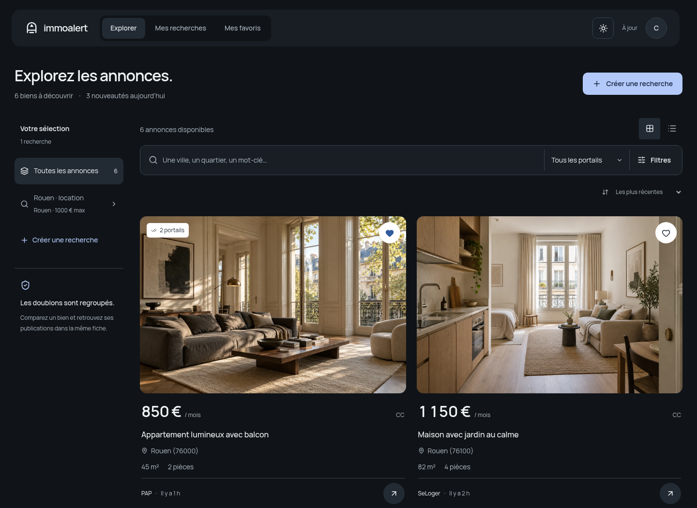

<details>
<summary>Voir le mode clair</summary>

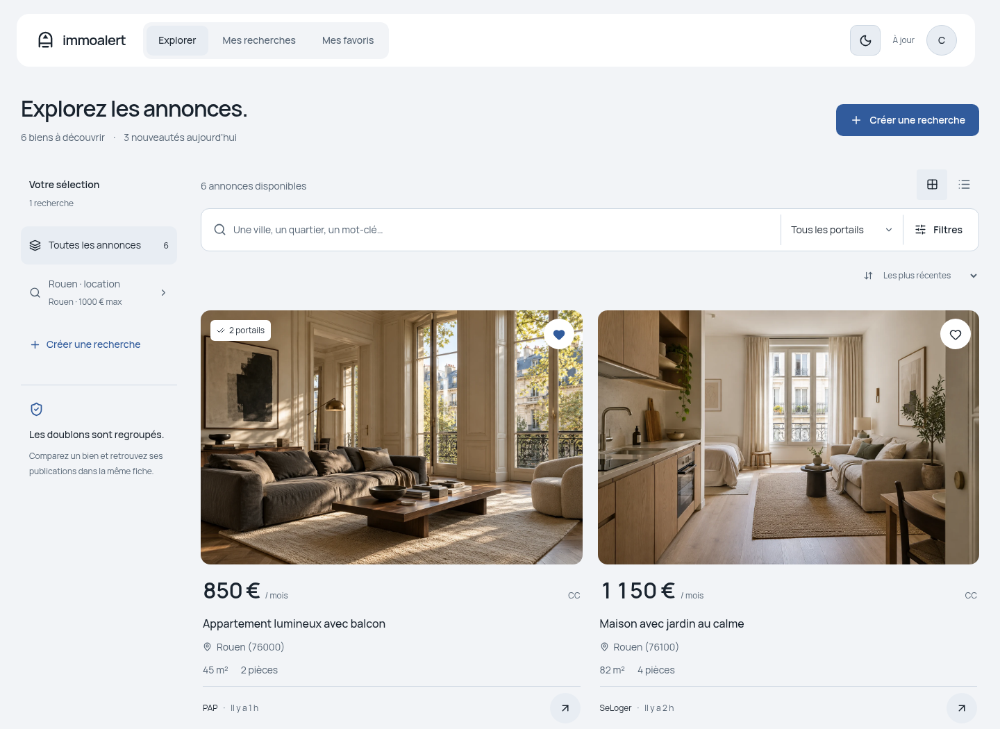

</details>

### Les détails d’un bien et la version mobile

<table>
<tr>
<td width="72%">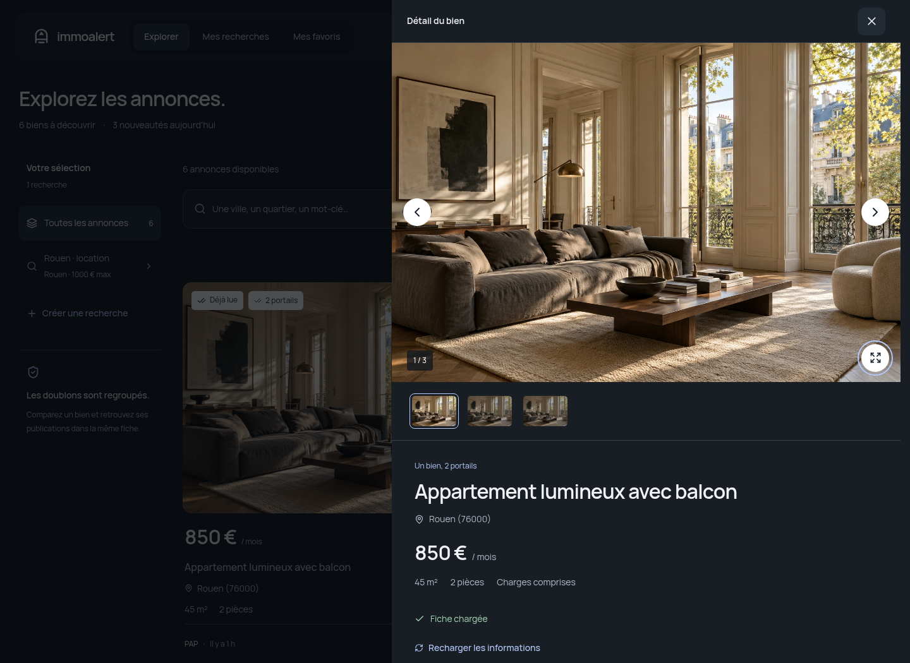</td>
<td width="28%">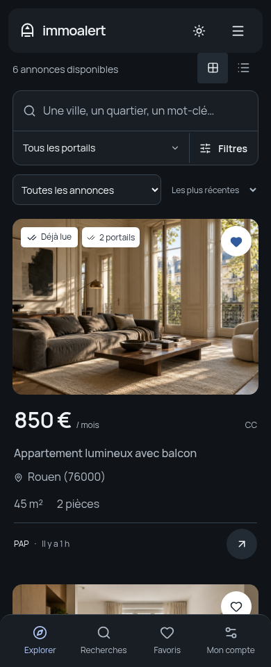</td>
</tr>
</table>

### Vos suivis, comparaisons et zones de localisation

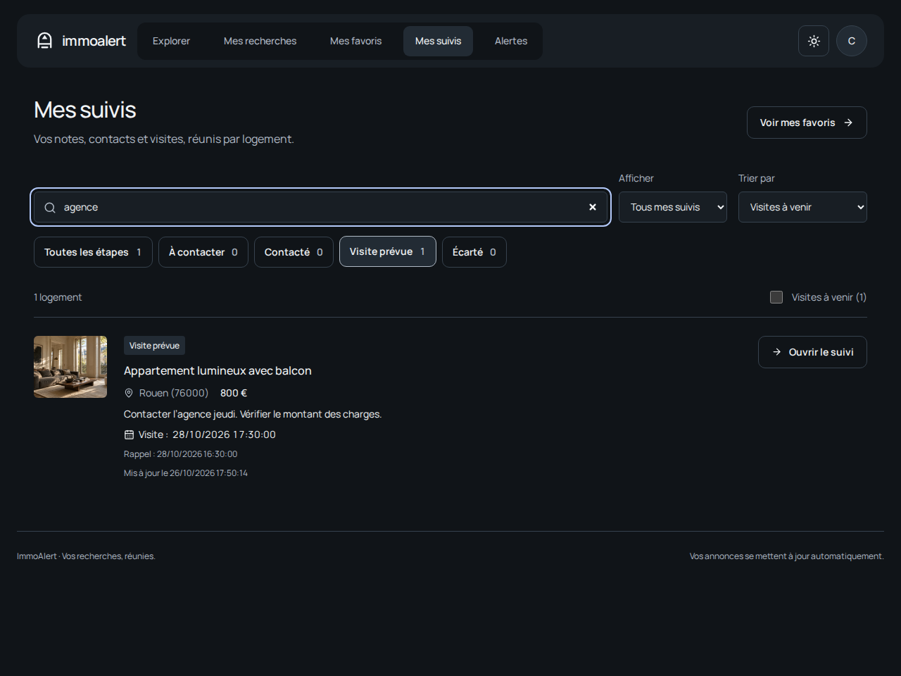

<details>
<summary>Voir le comparateur, la carte et les deux plans FlashProxy</summary>

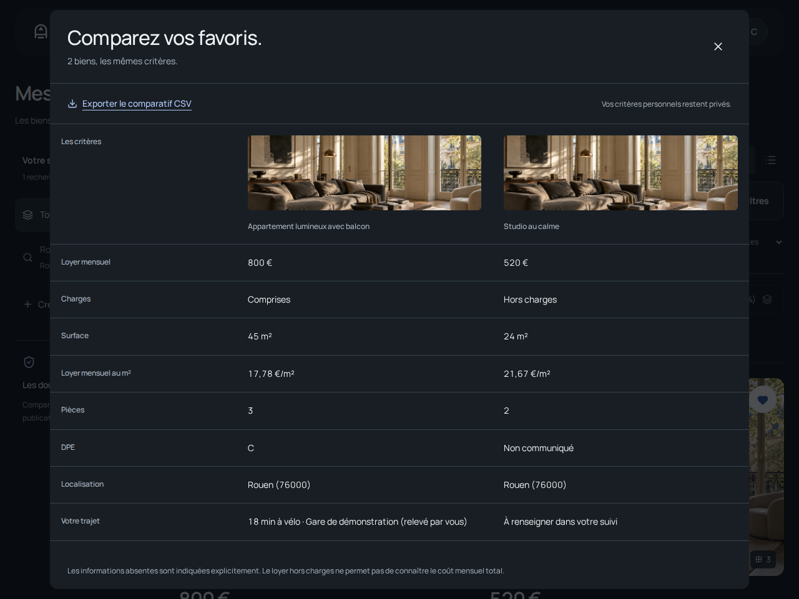
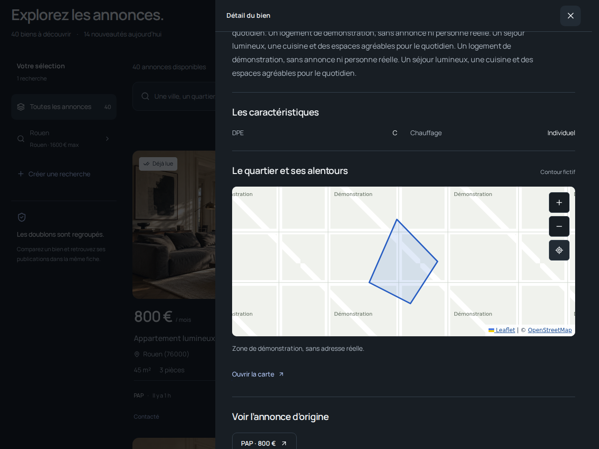
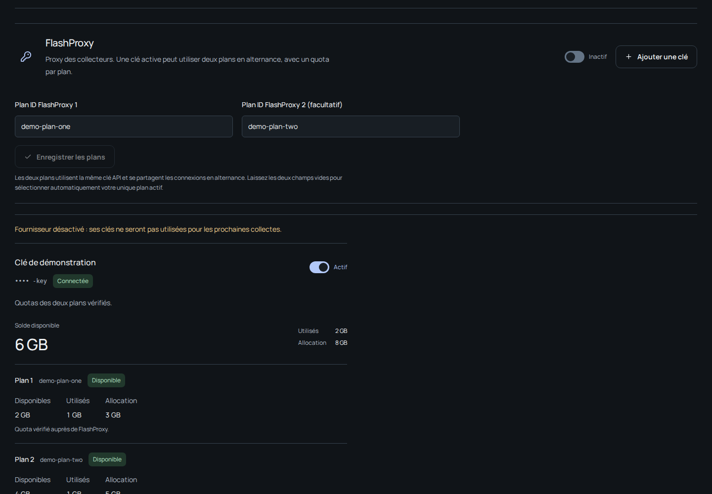

</details>

### Le poste de contrôle administrateur

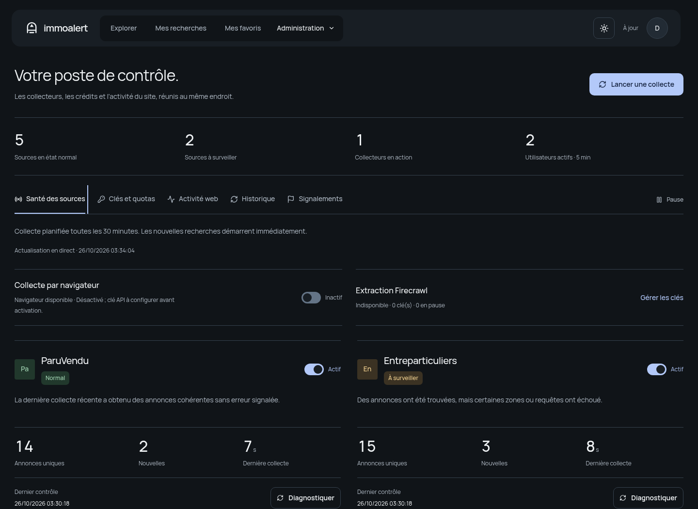

<details>
<summary>Voir le formulaire de recherche, les clés, le trafic et l’aperçu Telegram</summary>

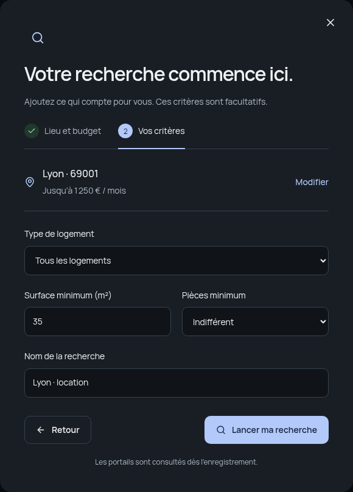

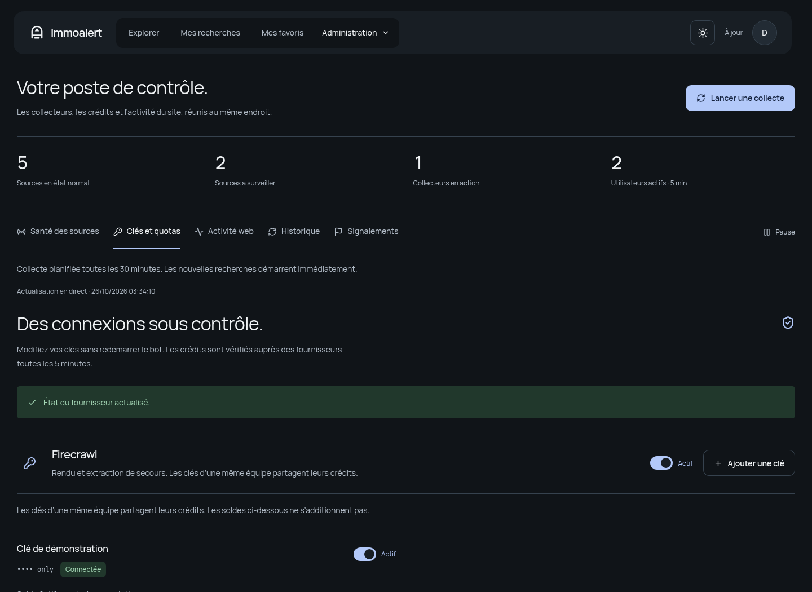

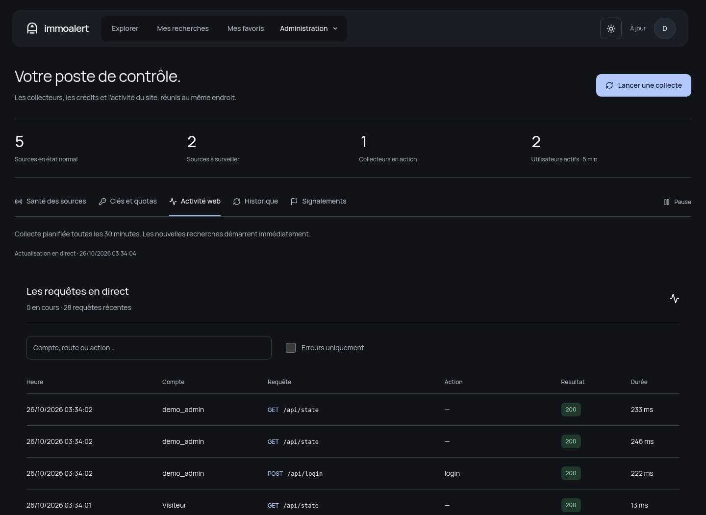


</details>

*Les captures proviennent de l’interface exécutée sur une base de démonstration isolée. Comptes, biens, illustrations et métriques sont fictifs ; elles ne montrent aucune donnée de production. L’aperçu Telegram est une illustration vectorielle. [Origine et reproduction des visuels](docs/assets/README.md).*

## Fonctionnalités

| | Ce que propose ImmoAlert |
| :--- | :--- |
| **Un flux commun** | Annonces récentes, recherche par ville ou mot-clé, filtres de prix, surface et pièces, tri et affichage en grille ou en liste. |
| **Un bien, plusieurs publications** | Comparaison de la localisation, du prix, de la surface et des pièces, avec une photo commune ou une description distinctive pour confirmer un regroupement. Les liens de chaque plateforme sont conservés. |
| **Des fiches détaillées** | Description complète récupérée, caractéristiques publiées, galerie de toutes les images collectées, miniatures et agrandissement sur le site. |
| **Une zone de localisation** | Périmètre délimité sur une carte interactive, avec la précision disponible et les approximations indiquées. |
| **Tous vos suivis réunis** | Page Mes suivis, recherche dans les notes, filtres par étape, visites, rappels et notes conservées pour les anciens favoris. |
| **Des favoris comparables** | Comparaison de deux à quatre biens, critères personnels de trajet, stationnement, accessibilité et export CSV. |
| **Des alertes réglables** | Boîte de notifications, baisses de prix, plages silencieuses et résumé quotidien facultatif sur Telegram. |
| **Telegram à la demande** | Alertes avec photo lorsqu’elle est disponible, favoris et bouton **Plus d’informations**. Les longues descriptions sont paginées ; les photos supplémentaires se consultent sur le site. |
| **Des comptes administrés** | Création d’un identifiant, mot de passe généré une seule fois, rôle administrateur facultatif, Premium, désactivation et réinitialisation avec révocation des sessions. |
| **Une recherche immédiate** | Enregistrer une recherche lance la collecte sans attendre la prochaine passe planifiée. Le site affiche les étapes, les portails traités et les résultats ; des cartes de chargement accompagnent l’arrivée des annonces. |
| **Des clés administrables** | Ajout, remplacement, activation et suppression des clés Firecrawl et FlashProxy, chiffrées et utilisables sans redémarrage. Deux plans FlashProxy simultanés, sessions et quotas séparés, dernier appel et erreurs de connexion. |
| **Une santé explicite** | État normal, extraction partielle, blocage, limite fournisseur, temporisation ou contrôle ancien. Un diagnostic individuel lance une vérification du collecteur. |
| **Une console de suivi** | Sources activées, collectes en cours, zones traitées, volumes bruts/normalisés/rejetés/uniques, nouvelles annonces, erreurs, délais et temporisations. |
| **Du trafic API en direct** | Requêtes en cours et récentes, compte, méthode, route, action, code HTTP et durée. Aucun mot de passe, cookie, corps de requête ni paramètre d’URL n’est enregistré. |
| **Une veille persistante** | SQLite, favoris, file d’alertes, historique des envois et reprise après erreur Telegram temporaire. |
| **Plusieurs déploiements** | Bot et site avec Docker Compose ; site sur Plesk mutualisé avec passerelle PHP vers le backend, y compris avec un tunnel HTTPS sans ouverture de ports sur la box. |

Les détails, photos et coordonnées dépendent des données réellement fournies par les portails. Une protection anti-bot peut bloquer une collecte. Des critères identiques ne suffisent pas à fusionner deux biens ; les vérifications restent prudentes. [Architecture et limites](docs/ARCHITECTURE.md).

### Les plateformes

**Leboncoin · SeLoger · PAP · ParuVendu · Entreparticuliers · Logic-Immo · Rentola · OuestFrance-Immo**

Les chemins HTML utilisent **Scrapling avec Chromium** comme moteur principal. **Firecrawl** prend le relais lorsque nécessaire ; plusieurs clés peuvent être configurées. **FlashProxy** est optionnel. L’administrateur contrôle les sources et le moteur principal depuis le site ou Telegram. [Configuration des collecteurs](docs/CONFIGURATION.md).

### Free et Premium

| | Free | Premium |
| :--- | :--- | :--- |
| Recherches | Une recherche principale | Plusieurs recherches nommées |
| Site, fiches, galerie et favoris | Oui | Oui |
| Telegram | Facultatif | Facultatif |
| Alertes Telegram | Différées, 5 minutes par défaut | Dès le traitement de l’annonce |
| Filtre en langage naturel | — | `/ai_filter` |

Le Premium est attribué par un administrateur. Aucun paiement automatique n’est intégré. Le délai d’alerte commence après collecte et traitement ; il ne garantit pas un délai de détection sur les portails.

## Installation

**Prérequis : Git et Docker avec le plugin Compose.** Le dépôt contient le backend **et** les sources du site dans `web/`. L’image construit le frontend et inclut Python 3.11, Chromium, Node.js 22 et Firecrawl CLI.

```bash
git clone https://github.com/ZEBDA1/ImmoAlert.git
cd ImmoAlert
cp .env.example .env
mkdir -p storage
```

Renseigner les valeurs propres à l’instance dans `.env` :

```dotenv
BOT_TOKEN=jeton_obtenu_aupres_de_BotFather
ADMIN_TELEGRAM_IDS=identifiant_telegram_de_l_administrateur
FIRECRAWL_API_KEY=cle_facultative_pour_le_secours
```

Puis démarrer :

```bash
docker compose up -d --build
docker compose ps
```

Le bot utilise le polling Telegram. Ouvrir sa conversation et envoyer `/start` pour définir les critères. La commande `/my_id` affiche l’identifiant Telegram.

### Activer son propre site

Le site est désactivé par défaut. Pour l’activer sur le serveur :

```dotenv
WEB_ENABLED=true
WEB_SITE_URL=http://localhost:8088
WEB_PORT=8088
WEB_DIST_PATH=/app/web_dist
```

```bash
docker compose up -d --force-recreate tgbbot
docker compose exec tgbbot python scripts/create_web_admin.py --login administrateur
```

Le mot de passe généré s’affiche une seule fois. Le site est accessible sur `http://localhost:8088` **depuis la machine qui héberge Docker**. Compose publie ce port sur la boucle locale ; pour un domaine HTTPS distant, suivre le [guide web](docs/WEB.md) et configurer l’origine publique appropriée. Un administrateur Telegram configuré peut aussi utiliser la connexion Telegram pour créer ses premiers accès dans **Accès**.

### Plesk mutualisé, sans SSH

Plesk héberge le frontend compilé et sa passerelle PHP. Le backend, le bot et les collecteurs restent sur un serveur permanent, joignable en HTTPS. La passerelle conserve son secret en dehors de `httpdocs`.

Pour préparer l’archive sur le poste de développement, avec Node.js 22.12+ :

```bash
npm --prefix web ci
python3 scripts/package_plesk.py
```

L’archive `dist/immoalert-plesk.zip` se dépose depuis le gestionnaire de fichiers Plesk. Elle ne contient ni base, ni identifiant de production, ni `.env`. [Installation Plesk et option Tailscale Funnel sans ouverture de ports](docs/PLESK.md).

Une archive déjà construite et son empreinte SHA-256 sont également disponibles dans les [versions GitHub](https://github.com/ZEBDA1/ImmoAlert/releases/latest).

## Architecture

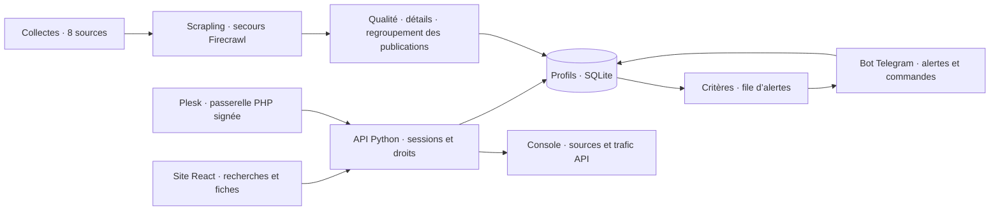

Les profils, recherches et favoris sont partagés entre site et bot. Les comptes sans Telegram utilisent le site et ne reçoivent pas de messages Telegram. Une liaison approuvée dans le bot regroupe les données avec le profil Telegram existant. [Détails techniques](docs/ARCHITECTURE.md).

## Validation

```bash
python3 -m pip install -r requirements.txt
python3 -m unittest discover -s tests -v
npm --prefix web ci
npm --prefix web run build
```

**407 exécutions de tests de régression** couvrent les collecteurs, le matching, les doublons, les alertes, l’authentification, les droits, les migrations et les API. Les appels externes y sont simulés. Des vérifications navigateur sur ordinateur/mobile et un essai réel de la passerelle PHP avec TLS complètent la suite. [Périmètre et limites de validation](docs/VALIDATION.md).

La CI teste Python 3.11/3.12, le build TypeScript/Vite, l’archive Plesk, la syntaxe PHP et l’image Docker. Les résultats sont accessibles dans [GitHub Actions](https://github.com/ZEBDA1/ImmoAlert/actions).

## Documentation

| Guide | Contenu |
| :--- | :--- |
| [Configuration](docs/CONFIGURATION.md) | Variables d’environnement, collecteurs, proxys, quotas et géocodage |
| [Site et administration](docs/WEB.md) | Connexion, comptes, rôles, données partagées et supervision |
| [Plesk](docs/PLESK.md) | Archive prête à envoyer, passerelle PHP et backend HTTPS |
| [Déploiement](docs/DEPLOYMENT.md) | Docker, mises à jour, sauvegardes et dépannage |
| [Développement](docs/DEVELOPMENT.md) | Backend Python, frontend, tests et ajout d’un connecteur |
| [Architecture](docs/ARCHITECTURE.md) | Collecte, déduplication, persistance, accès et alertes |
| [Nouveautés](docs/RELEASES.md) | Fonctionnalités de la version 2.1 et mise à jour |
| [Confidentialité](SECURITY.md) | Données exclues de la publication et contrôle avant envoi |
| [Validation](docs/VALIDATION.md) | Tests, contrôles d’intégration et limites |
| [Visuels](docs/assets/README.md) | Captures de démonstration et illustrations vectorielles |

Les fichiers `.env`, les mots de passe générés, les clés API, les sessions, les bases et `storage/` restent locaux. Les valeurs de configuration livrées sont des exemples. Les alertes transitent par Telegram si un compte est relié ; les URL transmises à un collecteur externe sont décrites dans la [configuration](docs/CONFIGURATION.md).

---

<div align="center">

**Conçu par [ZEBDA](https://github.com/ZEBDA1).**

[immoalert.work.gd](https://immoalert.work.gd) · Python · React · Telegram · Auto-hébergement

</div>
